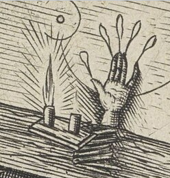

## 第七章 淫宴

**舒图尔班兄弟**被红宝石打动了。他们早已听说奥西登斯神殿外爆发了一场骚乱——神殿里显然也出了事，看样子可能还牵涉到火灾。神殿里有两个住户在墙外中了枪。有人爬上屋顶搜查。到了早上，司事没有像往常一样打开神殿大门。信徒们白白排了队。

显然，住在那大院子里的乞丐中，有一个够机灵，已经穿过城市跑去找舒图尔班兄弟了。

现在，小贼拉克尔希望能打听到帝国法务院的具体细节。她的买卖就没个尽头吗？

舒图尔班兄弟的信源看见，有个披袍男人从奥西登斯附近逃走；另一个乞丐也告诉这个线人，说当晚他在附近见过一对巨人和侏儒……

法务院的细节可以弄到，毕竟这么漂亮的红宝石很有说服力。不过，乔尔·舒图尔班坚持要当着拉克尔那个神秘资助人的面，把情报告诉她——她没法合理否认这位资助人的存在。乔尔想见见这个犯罪行当的新金主。改头换面的拉克尔匆匆搬离了原先的住处。有人多嘴说，是一个奴隶巨人护送她离开的。

会面地点应该选在中立地带。拉克尔不是对色欲教派很好奇吗？那么，一周后，中立地点就选在马哈巴特区[^1]的一栋房子里。拉克尔的资助人，还有她本人都受邀参加一场*娱乐活动*。乔尔向拉克尔保证，不强制要求亲自下场参加嬉闹。全凭她自己和她的资助人高兴嘛！巨人和侏儒也可以一起来。这两位说不定能成为有趣的表演者。

---

**“乔尔·舒图尔班**是想让我们心神不定，”贾克说，“这样我们中就可能有人言行失检。”

可他自己不正希望自己理智扰乱、陷入疯狂吗？

“我的心志坚毅，足以抵御肉欲诱惑。”莱克斯宣称。现在，必要时他还有那根大腿骨可以抚摸。莱克斯已经开始打磨上蜡，准备把那根股骨做成骨雕。他工作时会向罗格·多恩祈祷；祈祷是无声的，以防拉克尔听见。

格里姆撅起嘴。“哈，让我这种矮人跟普通人类一起搞什么群交？想都别想。要是有几个我族的壮实女人，我还有可能动心。”

---

**整整一周的等待**让人沮丧——虽然舒图尔班兄弟确实需要一周时间，才能把拉克尔要的情报搜集起来。不过在此期间，还有许多事情要做。

拉克尔从城南绍迪加尔区的商业学院偷来了一顶催眠盔。这对她来说不算挑战，不过他们确实需要一顶。催眠盔的数据盘里有标准帝国哥特语程序，供准备前往外星的出口商使用。贾克把数据盘扔掉了。

接下来，拉克尔又从哈基姆医院偷来一把激光手术刀。格里姆则去工业区买了些设备。莱克斯组装了一套成像系统，这样他就可以在不直视的情况下观察阿祖尔·彼得罗夫的亚空间之眼。

隔着屏幕，那只眼睛还能杀死观看者吗？格里姆找了一个麻风病人来验证。他蒙上那人的眼睛，绕道把他领到宅邸里，答应事后给五十谢克尔，好让这个可怜虫去上述那家哈基姆医院买祝圣药膏。

这个麻风病人的病情还没有发展到侵蚀神经的痛苦地步。到目前为止，麻风病已经剥夺了他几乎全部的身体感觉——他祈祷药膏可以帮他找回这些感觉。麻风病人会不会害怕在这未知的目的地遭到虐待？就算主人不怀好意，也很难让他受多大的罪，毕竟他身上大部分坏死的肉早就麻木了。

在一间他看不见的屋子里，有人给他套上一个大头罩，再解开蒙眼布。填满麻风病人视野的，除了头罩就是一块小小的显示屏。有人告诉他只需盯着屏幕，把看到的东西说出来。

“是一个黑球，”麻风病人说道。“夹在夹具里。球的正面刻着一个图案，是一个符文——”

“继续盯着球。”

麻风病人盯了十分钟也没有中风，之后他又被蒙上眼睛，带回医院附近放走了——他残缺的手里也确实拿到了五十谢克尔。

显然，先前与他搭话的矮人，是他命里奇迹的中保。

出于好奇，格里姆又在医院门口晃悠了一会儿。半小时后，一个模样骇人的麻风病人跌跌撞撞地出来了，他身上只剩一条缠腰布，尖叫着让人往他身上泼水，逢人哭喊自己身上着火了。显然，那种祝圣药膏确实刺激到了他麻木的血肉和神经。没有水，麻风病人便在街上冰冷的尘土里翻滚，徒劳地想让自己凉快下来。

趁大腿骨还泡在石蜡里，莱克斯拿起激光手术刀，开始处理阿祖尔的眼睛。莱克斯没有计算器帮忙处理梯度和曲线，而且他只能通过屏幕观察手术过程，无法直视它；不过他粗大的手却灵活又仔细。站在旁边看他干活本来会很有意思——可只要不小心瞥到真正的眼睛，旁观者的神经系统就可能遭到重创，甚至当场毙命。莱克斯自己也戴着两侧有遮挡的护目镜[^2]，免得无意间往旁边一瞟。

为了镜片的对称性，眼睛正面的符文必须削掉。削掉又怎样？那符文是指向网道黑图书馆的路标，可他们又不想回去。

啊，贾克的修会该多想拥有这种路标。

审判庭和圣锤修会注定要失望了——不过在动手前，莱克斯还是先把符文临摹到了长驼颈皮纸上以备万一。如果将来还有哪位领航员愿意牺牲自己宽广的亚空间视野，就可以把符文复刻到那位志愿者的眼睛上。

宇宙中肯定还从未有人拿领航员的亚空间之眼做过单片眼镜！

镜片成品应该足够纤薄，必要时能让贾克透过镜片视物。终于，这硬如黑曜石的眼睛打薄得差不多了，使浑浊的镜片可以嵌进厚实的单片眼镜框里，前后各装一块厚珐琅铰链盖片。

削得这么薄，亚空间之眼的致命目光会不会大大减弱？还是说，这镜片反而会成为某种精粹，某种致命的浓缩？

“我怀疑咱们还能不能把那个麻风病人再弄回来。”格里姆说，“这会儿他八成已经跳进比希什蒂河淹死了。不过我想，为了保险，还是得拿人试试，不能再找一只倒霉猴子……”小个子挠挠头，咧嘴一笑。“不过也没必要在家试。贾克，我们俩去不太平的街区溜达一圈，等麻烦自己找上门。这样就算是有蠢货自己找死了。”

不能带莱克斯一起散步。他那身板会把麻烦都吓跑的。可要是带上拉克尔……

就这样，三个人动身前往工业区，也就是贝拉贡吉区。贾克的长袍下面穿着网甲。格里姆还是那么信任自己的绗缝防弹夹克。拉克尔穿一条闪亮的蓝色丝袍，里面是贴身保暖衣。*她*不会成为刀子或者子弹的首选目标。绑架倒是可能。还有凌辱。但不会有人一上来就要她的命。

贾克和拉克尔手挽着手漫步，像个带着情妇招摇过市的大老爷。格里姆落后一点，像个矮墩墩的狗腿子。

贝拉贡吉区烟雾弥漫的工厂贫民窟里住着几十万人。随便哪家生产载具零件的小厂子里，都住着在这儿干活的全家老小。厂子外面的街道上可能又有另一家人，正忙着切割打磨铁丝，用来制造钉子。拐过街角，还有十来家别的作坊，有的忙着焊接，有的压层，有的把蝶形螺母浸进有毒液体里电镀。每一家血汗作坊都死守着自己杂乱的地盘。摇摇欲坠的房屋里外，设备隆隆作响，砰砰震动，突突打颤，喷出烟和废气。人们说话全靠喊。到处都有人咳嗽。卖水的、卖雪葩的、卖鱼馅饼的，都助长了这片喧闹。

在这工业蚁巢里钱财外露、到处闲逛，迟早都会遇到袭击的。

巨大的太阳像烧红的盖子，悬在烟雾上方。事实上，因为到处都在喷烟，机器又疯狂运转，贝拉贡吉要比寒冷的香达巴其他地方温暖几度。许多劳工都习惯脱掉身上的粗布工装。没过多久，在一条巷子里，四个瘦骨嶙峋的家伙就拦住了贾克、拉克尔和格里姆。这几个劫道的已经跟了三人一阵子。现在他们抄近路赶到了前面。

这伙投机分子中有两人从破衣服里掏出弹子枪。另两人亮出了花里胡哨、形似切肉刀的剑。显然，剑刃是塑料做的——锋利而柔韧的塑料，制作时染了几道血红条纹，好显得杀气腾腾。一把红刀上画着蓄势待发的绿色蛇头。另一把则画着一只凶恶的绿眼睛。

一只眼睛。多么吉利。多么合适。

格里姆笑了。

贾克那只翻盖单片眼镜，是让他看起来更像个纨绔子弟，而不是更阴森可怕了吗？“要是够聪明，”他拖着腔调说，“就别挡我的道。”

“你的道就到此为止了，”对方回答，“除非把那妞儿交给我们，拿去马哈巴特卖。”说话的那人一直嚼着血果仁。他朝尘土里吐出一口猩红的唾沫。

“要是够聪明……”贾克再次警告。

另一人晃了晃手里的剑。“你*两只*眼都瞎了？”他问。

第一个人懒得再废话。他用弹子枪朝贾克胸口射了一发，那里目标面积最大。

贾克的长袍被打穿，袍子里的网甲瞬间变硬，吸收并分散了冲击。和爆弹命中相比，这一下简直算不了什么。压扁的子弹掉在贾克脚边。

贾克拔出激光手枪开火时，又有一发子弹打中了他。迸发的能量团把枪手打飞。另一个目瞪口呆的枪手也被格里姆一枪放倒。拿蛇刃的转身要跑，结果背上挨了一枪。只剩下一个：拿眼刃的人。

“不许动！不然就用激光打你的腿！”

让他从此变成瘸子。

那男人盯着拉克尔看了一会儿，仿佛很想朝她扔剑，把这丝袍女人从有钱的外地佬手里夺走，或者至少毁了她的脸。

“把剑扔下！”贾克吼道。

男人照做了。他跪在地上，连连求饶。格里姆绕到他身后，跪在他小腿上压住他，将他的双手反剪到背后。然后格里姆闭上了自己的眼睛，仿佛等待处决的是这个矮人。

贾克跪在俘虏面前满是垃圾的尘土里，用一只眼睛，盯着瑟瑟发抖的实验对象。在这个阶段，贾克还不打算透过那片曾是阿祖尔·彼得罗夫亚空间之眼的镜片视物。这种极端手段必须留到以后，等到他被附身时，再对着镜子睁眼看向自己，要么把恶魔从脑子里赶出去，要么就为此而死。他只是掀开了前盖。当然，俘虏瞪大眼睛，想看看盖子下面藏着什么。

一阵咕噜声从男人身体深处升起，就好像他的灵魂正从肚子里被扯出来，连带着肺里的所有空气。男人双眼鼓起，流出粉红的血。随着他吞下自己的舌头，他濒死的喉音戛然而止。他的脸变成紫红色。那干瘦的身体痉挛起来。

贾克把盖子扣到镜片上。他摘下单片眼镜，塞进长袍里面。

“可以睁眼了，格里姆。”

格里姆松开男人的手腕，尸体向前倒下。然后格里姆捡起那把眼刃，捅进垂死男人的后背，几乎深至剑柄。

“这样看起来比较自然。”小个子朝巷子更远处的一小群围观者点头。

他们畅通无阻地离开贝拉贡吉。贾克不再挽着拉克尔，可她仍走在他身边。她身上的蓝袍对小偷而言一定很讨厌，那实在太惹眼了。

“巫师托德·扎帕斯尼克。”她嘟囔道。

“你明明知道，”他厉声说，“杀人的只是领航员亚空间之眼的细胞核。”

“只是。”她重复。尽管穿着战斗保暖衣，她还是打了个寒颤。“等我们去了马哈巴特，又会有什么样的‘只是’？刚才那些恶棍打算把我卖到那里去。”

“听着，梅林迪，”他对她说，“我们不会参与淫行。”

他意识到自己刚才喊了拉克尔什么。他表情痛苦，一言不发地继续往前走。

---

**他们雇了一辆**豪华轿车去马哈巴特区。穿着廉价灰色防弹甲的保安混在人群里，守在游乐场所外面。赌博、美食、淫欲、毒品。发光招牌闪闪烁烁。

*马哈巴特，尽享欢乐！*

*干净阉人！*

*欢乐汁，一剂只要五十谢克尔！*

*百万金钱等你来！*

*有特殊需要吗？*

*婊子带你上天！*

那些保安有古铜色的皮肤、锐利的蓝眼睛和鹰钩鼻，看起来都来自同一个氏族或部族。他们中没有特别年轻的。所有人都把黑发扎成顶髻，像头顶上有一颗闪亮的大纽扣。“盔甲看着像帝国卫队淘汰下来的破烂货。”格里姆评价道。

当然了，萨布洛布也要向帝国缴纳什一税，献出最优秀的战士组成兵团；具体而言，献出在寒冷沙漠作战的专家。萨布洛布的兵团应该正处在宇宙的其他地方。这些人肯定是服役期满后回了母星。负责监督征兵工作的军务部办事处并不设在首都，而是设在北方一块环境更严酷的大陆上。行星军队的主基地也在北方，巴德沙阿领主倾向于让大军远离首都。真有紧急情况，就把部队空运过来增援香达巴的驻军。同时，军队主力负责镇压各路不听话的交战部族，并强征新兵，把其中最优秀的送往其他星球。

私人巡逻员带着自动枪，不过他们会对经过的顾客微笑。贾克一行四人从深色车窗的豪华轿车里下来时，他们也冲四人笑了笑。显然，星际的经历让这些前帝国卫兵习惯了城市里的精致享乐，不过能活过军旅生涯的没一个会是软蛋。

舒图尔班兄弟邀请拉克尔和她资助人前去的圆顶建筑名叫“销魂之屋”。一个金线镶边制服的胖仆人把来客领进主厅。客人们坐在供应饮品的桌边，色情全息影像在他们中间慵懒地闪动。中央的高台上，男女杂技演员正进行撩人的表演。空气里弥漫着醉人的麝香和广藿香味。

他们穿过主厅，继续走向官能套房。这里专为贵宾和私人聚会预留。套房地面铺着玫瑰色的天鹅绒软垫，柔软而有弹性。低矮的软榻隆起，就像人体上的乳房一样，与地板浑然一体。五十来个期待寻欢作乐的人穿着五颜六色的丝绸，懒洋洋躺在这些天鹅绒“乳房”上。他们多数是中年男人，也有几个成熟的女人。灯光昏暗而呈玫瑰色。一名四肢与躯干都绘有黑色螺旋的年轻女郎在人群间穿梭，端着托盘，盘子里盛着发光的吸入剂。她每在柔软的地面上迈出一步，身体都像弹簧一样弹跳着。

“各位先生，请脱下鞋子和靴子……”

莱克斯没有靴子可脱。这个纵欲享乐的巢穴，与要塞修道院的塑钢甲板是多么不同啊。除了那昏暗的灯光外，这里又和贾克失落的恶人苦难号那葬礼般的内设多么不同。“没洗脚哈，”格里姆有点尴尬地嘟囔，同时脱下他的大号战斗靴。

“啊，”拉克尔轻声说，“那是舒图尔班兄弟——”

两个男人从软榻上起身。两人都是深色卷发，额头宽阔，眼睛大而水润，塌鼻头，笑容灿烂。镶了几颗金牙。夸张的胡子横在咧开的嘴巴和短小的鼻子当中。

“乔尔是那个更壮实的。”也是那个狡猾的。乔尔右脸纹着一只长颈驼，每次他活动面部肌肉，那东西看起来都像在原地小跑。

他暴脾气的兄弟右脸上有一道疤，疤上缝着一颗硕大的深红火榴石。这团红肿的宝石就像是他体内永不停息的熔岩喷发。

“来和我们放松放松。”乔尔邀请。

很快，贾克、巨人、亚人和蓝绸衣女贼，就和两位舒图尔班一起，坐进了环成半圆形的软榻里。弹力十足的年轻女郎端来吸入剂，贾克替自己这一行人拒绝了。莱克斯只发出几声混混式的哼哼。格里姆则嘲笑地扫了那少女一眼。腰一点都不粗！

“偷了奥西登斯神殿里一根属于奥里恩斯神殿的圣骨？”乔尔试探道。

贾克不以为意地向莱克斯点点头。“给我的獒犬找根骨头磨牙。我们试了试拉克尔的本事。”

“她和我们刚认识她那时候比起来，简直变了个人。”

“她母星上都是可以变形的人。”

“她也是这么跟我们说的，”乔尔探身向前，“你是变形巫师？拉克尔还向我们打听过超验的变形者。”

“哪里有那种人？”

“身份至今是个谜，托德爵士。”

“一颗好红宝石能买来不少消息。”贾克向马达尔·舒图尔班脸上的榴石一瞥，这位舒图尔班兄弟似乎顿时怒火上涌。马达尔是不是觉得，贾克心里认为他的榴石还比不上一颗红宝石？他从路过的年轻女郎那里抓了一颗吸入剂球，在鼻孔下面捏碎，深深吸了一口。

“来这儿就是为了放松，”马达尔说，“泄泄火气。”

乔尔又刺探了几句。贾克顶了回去。乔尔晃晃一根戴戒指的手指，戒指上有枚半个谢克尔大小的数据盘，就像印章一样。显然，法务院的图纸就在那块数据盘里。在交出戒指前乔尔还有好奇心要满足。不过他看起来并不着急。

门像光圈一样打开，侍者推着一只气球轮笼子进入房间，盼顾着的寻欢作乐者纷纷叹出一口气。

笼中蹲着一个盲眼变种女人。这台古怪装置滚上有弹性的地面，那女人抓住栏杆保持平稳。她身上长满鳞片，质感很像贾克今晚穿的网甲。也许那女人其实穿着蜥蜴皮紧身连体衣，而不是真的身上长了鳞——毕竟她苍白的脸蛋是很滑嫩的。光线昏暗，看不分明。

随后，可以清楚地看到，女人两条腿在臀部往下连成了一体，像蛇一般盘绕在她身边，越往下越细，看起来只有肌肉，没有骨头。她的眼睛像煮熟的蛋白——就像经过灵魂绑定的星语者似的！她手臂上装饰着闪闪的镯子。

“拉弥亚，拉弥亚！”[^3]客人们向她欢呼。

为什么要把她关在笼子里？为了不让她一扭身钻进人群？为了不让客人闯进她自己的空间？为了给她几根栏杆，好让她抓住？她是个什么角色？

她像催眠一样来回摇摆。

这个变种女人肯定会把色情幻想投射到人们脑子里！难道这就是她那虫子身体出生时没被掐死的缘故？她靠诱惑父母活了下来……后来她也是靠这招逃脱了邻居、神甫和变种人猎手的杀手？等她长到青春期，难道她即便身体畸形，也真的被送去接受星语者训练了？她是不是甚至接受了灵魂绑定，失去了视力，换来了传心天赋的增强？贾克努力设想她作为普通星语者工作的场景，想象她收发加密信息，或者商业数据流。

从生命最初的时刻开始，她就为了活命用情欲去撩拨人心，可那双腿却令人沮丧地融为一体，让她永远得不到肉体的满足。她该有多么旺盛的性欲啊！

“拉弥亚来了，”蛇女以婉转而爱抚的嗓音说，“释放所有的秘密欲望吧。任它在你们的神经上变得真实。”

啊，这蛇女，她不是什么被囚禁和剥削的怪胎！完全不是。她是名副其实的老板娘，是销魂之屋内殿的老鸨女王。

“那边那个是巴蒂·巴德沙阿。”乔尔朝一个满脸淫相的家伙点点头。那人戴着硕大的银圈耳环，环上挂着像在表演杂技的微缩裸体人偶，闪烁着五彩斑斓的冰蓝色调——无疑是用钛做的。“我们总督的一个侄子……”

真上流啊！

这不是贾克以为的那种淫宴。这里要淫乱的是脑子。想坐怀不乱恐怕不太容易。贾克可以用灵能抵抗蛇女传来的感觉——如果他想的话。但格里姆、莱克斯和拉克尔呢？这场色情降神会已经开始了。贾克的衣服里仿佛有一根根手指在皮肤上游走挑逗。就像他穿着网甲束衣也没用。无形的手指不受阻碍。它们怎么会如此机灵，知道该挑逗和刺激哪些神经？唉，因为他自己心里知道。梅林迪，那位受过训练的艺伎——正如她受过刺客训练，曾以同样的方式触碰过他。

难道是梅林迪正从坟墓的彼端与他无声地交流？无需词句，以抚触下达命令，拨弄心弦？她的魅魔是否正悬在与他一膜相隔的地方？若是彻底臣服于她的怀抱，可否把她拉过来，让她再次靠近现实？

又或者，这会为色欲恶魔的附身打开一条路？没错，就在此时此地。贾克曾目睹维塔利·古戈尔屈服于色孽附身。当女魔蹂躏维塔利时，贾克就在那必死无疑的领航员的光环里。啊，要是在这里被附身，让色欲肆虐——却又想办法踉跄着走向一面镜子，从袍中取出眼球镜片，打开盖子，直视自己被附身后的双眼，让恶魔凋零，将其放逐回亚空间！如此便能获得启明！这难道可能吗？

幽灵般的手指游遍贾克全身，如此甜蜜，如此折磨。

他开始用圣仪般的语言祈祷。*“降临吧，欢愉！哟呵！啊，欲望，我纵情渴求！”*这样的祷言他以往从未念过。这和献给在尘世永受苦难的圣者的虔诚祷告截然相反。这是在召唤人格化的色欲。

在他周围，参加这场淫秽仪式的人们都在呻吟。多数人都已经忘了彼此。有几个翻过身，在天鹅绒软榻或者地面上扭动。有些人仰躺着，喘息着，仿佛正与想象中的欢愉肉体交合。贾克隐约意识到，那个待在她自己选定的笼子里的蛇女，正在吸收这些狂热而奇幻的感官反馈。笼子是为了拦住她，让她不会徒劳地钻到翻滚的人群当中，失去对自己灵能情色力量的把控。真要发生这种事，那么色欲的恶魔很可能会有所感应。它们会循着信标飞速赶来，通过能量的转化获得实体，显形为物质化的恶魔，取代人们想象中的魅魔。贾克将自己的灵能感知向外延伸，发出可怕的邀请，故而他已经站到了召来这一切的边缘。拉克尔在自己的迷乱中扭动着。

格里姆喘着气，“格里姬，格里姬！”看来格里姆到底是真有个死掉的老婆。

莱克斯正用左手狠狠扇自己巴掌。他的嘴唇坚定地念出那个名字：*罗格·多恩！*

马达尔·舒图尔班咧着嘴笑，口水直流，欢乐忘形。他的兄弟乔尔还保持着警醒。

突然，拉弥亚尖叫起来：

“这里有一位，自从被改造成超人，就再也没碰过女人！这里还有一位，欲求着一名死亡女士——”乔尔·舒图尔班听得聚精会神。

色欲混沌神的诸多面相正在汇聚。它们就快要抓住一条通道——在血肉中显形了。贾克的血肉？还是其他人的？

可怜的理智把贾克从悬崖边抓了回来。他抵抗着那些无形的手指，从袍子里抽出力场杖。太晚了。

笼中的拉弥亚昂起身体，响亮地浪叫起来。蛇女正在被附身！因为贾克作出了抵抗，混沌力量转而进入拉弥亚灵能色情能量的漩涡。

销魂的叹息开始变调，转为痛苦而欢愉的哭叫，仿佛有锋利的指甲抓挠着那些身体。

莱克斯像摇晃布娃娃一样摇拉克尔，让她清醒过来。接着他痛揍了格里姆，力道伤筋不断骨。

道道血痕出现在寻欢客的丝衣上，看不见的利爪正以甜美的变态方式刺激他们的身体。鲜血开始浸透丝绸与天鹅绒。

马达尔·舒图尔班脸上的榴石正熠熠生辉。激情将他彻底淹没。他忽而发狂，扑向另一个自我——乔尔。马达尔两根拇指戳进乔尔的眼球。乔尔痛苦地惨叫，痛到不知该如何反抗。马达尔口吐白沫。他在愈演愈烈的污秽狂喜中亲吻自己的兄弟。两根拇指越按越紧，像要一直深挖到脑子里，和另一个自我抵达终极的交融。

拉弥亚就要冲破笼子，试着用她的变种尾巴直立行走了。

莱克斯抓住乔尔乱甩的手。他没能把戒指拽下来。他不想硬掰数据盘，怕把它弄坏了，就低下头凑到乔尔手边。片刻后，莱克斯抬起头时，乔尔已经缺了一根手指。莱克斯把戒指连着手指一起咬下来了。乔尔残缺的手软软地垂着。这时他要么已经死了，要么脑组织被压碎，已经成了白痴。马达尔怒吼起来。他的拇指还卡在兄弟颅骨上血淋淋的眼窝里。

贾克唤起心中的厌恶，力场杖对准笼子释放。能量闪耀焕发。狂乱刺眼的射线大放光芒，频闪着把天鹅绒房间和那许多抽动的身体照亮。一团锯齿状闪电胎膜般裹住拉弥亚，接着向内塌陷，吞没了自己，也吞噬了她的灵魂。

奔涌的光影仍然在软垫房间里畅游。明亮而舞动的剪影啊！

贾克再次释放力场杖，这次能量较弱。莱克斯把拉克尔和格里姆拽起来，一手拎一个，像提着木偶一样。他施加的动作先教会了二人踉跄，继而找回了四肢的用法。

主门已经敞开。还是那个金线镶边制服的仆从，难以置信地瞪着官能套房里的景象。躯体遍地横陈、呻吟不止、血迹斑斑，看起来比起按摩更像屠杀未遂现场。一个发光的剪影朝他冲了过去。侍者惊恐地尖叫起来。

剪影啪地消失了。

贾克和莱克斯拖着摇摇晃晃的格里姆和拉克尔，从仆从身边冲过，闯进主厅。几道剪影紧随其后。这些剪影飞蛾扑火般朝那些搔首弄姿的色情全息影像飞去。全息影像随之变化：眼睛变得狭长、肿胀且碧绿；那迷人的臀部长出了带倒钩的尾巴。

恐慌爆发。桌子掀翻。一口钟铛铛作响。

警钟很快招来了两个古铜色皮肤的保安，头顶都盘着那种油亮黑发扎成的大发髻。销魂之屋里乱成了什么样！这场艳舞秀又把人吓成了什么样！两个前帝国卫队成员跳到桌上，大吼着“趴下，趴下！”并举起自动枪朝那些可怕的变异全息影像开火。贾克一行人躲到一尊比真人还大的纯白大理石裸体女子像背后。高速子弹贯穿影像打进墙壁，也打进客人的身体。有两发子弹从雕像上弹开，大理石巨型裸女像碎屑四溅。

真人杂技演员已经停下了表演。他们不也是这场让客人惊恐万状的表演的一部分？子弹打死了好几个演员——就在那骇人的全息影像接连闪烁着消失之时。

---

**乘坐豪华轿车**返回宅邸的路上，莱克斯把嘴里的手指吐了出来。他们和司机之间隔着隐私屏障，又与香达巴隔着一层脆弱的烟色玻璃。拉克尔已经又能开口了。

“那可以做成一根光荣之指[^4]，”她说，“如果托德真的是巫师——”

*“我不是！”*贾克吼道。他刚刚拒绝了那个近得可怕且不请自来的机会。“嘿，什么是光荣之指？”格里姆问。

“从一个死状凄惨的人身上拿一根手指下来，”她说，“搭配合适的咒语腌制风干。之后点燃它，它就可以给你指路，并隐藏你的行踪——直到烧光为止。”

“太合适了，”格里姆说，“正好用来闯法务院。”

“迷信！”莱克斯吼道。他把左手半握成拳，对着拳头低声说，“比夫，耶雷米，你们刚才帮助了我。我祝福你们的名字；还有罗格·多恩……”

“不是迷信，”贾克喃喃，“是一点有效的恶魔术。我是这么认为的。”

“世上只有一种光荣，”莱克斯肯定地说，“那就是泰拉皇宫里的荣耀之柱。”在那里，早已死去的帝国之拳的骷髅，还光荣地嵌在一座半公里高的塔楼中，在他们破碎的铠甲中咧嘴而笑。

“该死，得专门找人给我做双新靴子了。”格里姆说。因为他、贾克和拉克尔现在都像莱克斯一样光着脚。

---

**销魂之屋里**发生的事让四个人全都惊魂未定。为了提振士气，格里姆需要做一顿大餐。像进口格洛克斯兽舌这样的佳肴，自然要配上当地最上乘的灵酒和烈性麦酒。

一开始主要是格里姆在猛灌灵酒。拉克尔也跟着他喝。真正的梅林迪会允许自己喝醉吗？像拉克尔现在这样？贾克小口啜饮，毕竟是他准许了大家放纵一回。莱克斯也像在参加仪式似的喝了这种火辣的烈酒，反正他的特殊器官会解酒的。

没多久，醉醺醺的格里姆就开始打嗝。

“哦，祖宗啊，*嗝*，今天是我的命名日[^5]。哦好吧，*嗝*，就算不是今天，那也肯定是——”

“顾着点你的身体。”莱克斯责备他。

小个子不高兴了。“你的身体是荣耀的圣殿？那，*嗝*，要这么说，我的就是个猪圈。谁在乎？闹起乱子来，猪圈比圣殿还能撑。”格里姆举杯。“敬你，莱克斯，敬你的圣殿！敬帝皇圣子，不管他们在哪个犄角旮旯，先假定，*嗝*，他们真在世呢。敬幕后盘算的光照会。敬你，头儿！”贾克突然抓起一大壶麦酒——畅饮豪饮，灌醉自己的感官。他又拿起灵酒开始对瓶吹。

坐在拉着黑帘子的餐厅里，贾克摇摇晃晃。奥秘的能量是不是还萦绕在近旁？他看向假梅林迪时，眼前是不是在晃动？他直截了当地对拉克尔说：“跟我进屋，就现在。”他还带上了那根断指。

---

**贾克和拉克**尔举行了怎样的仪式——只有在调查邪恶时，曾通过代理，探索至变态深处的审判官才能知道。

后来两人回来时，拉克尔脸色惨白，身子发抖。贾克汗津津的，浑身燥热。格里姆已经打起呼噜，脑袋枕在桌上。莱克斯坐在那儿，身前摆着打过蜡的大腿骨，就好像那真是一头獒犬啃剩下的骨头。他正在一丝不苟地抛光打亮。

“色欲——还是变化？”贾克对着空气大声问。他挥舞着手指。手指上的戒指和数据盘已经取下，如今变得僵硬，有了皮革的质感。

“看啊，光荣之指！给我的假梅林迪，我的小贼，当一盏流明灯。她的身体愿意，她的灵魂却避之不及！也许我正成为法师，不需要色孽，不需要奸奇。”

莱克斯阴沉地擦着骨头。

过了一会儿，星际战士对贾克开口：“审判官阁下，如果你疯了，那么即便违背誓言，我也可能不得不杀了你。”贾克一把将桌上的空灵酒瓶扫落在地。瓶子在黑色石地板上跌得粉碎。这声巨响都没把格里姆吵醒。

“杀了我，”贾克说，“或许是正义之举，可也会摧毁一切希望。”

“或许吧。尸体的手指随你使用。我自己的手指只会敬奉这根腿骨。”

拉克尔麻木地听着。

---

[^1]: 本章的阿拉伯词在此列举，作者取用的词都很直接：

      1.马哈巴特Mahabbat，阿拉伯/波斯/土耳其语中的爱、奉献之意。
      
      2.绍迪加尔Saudigar，意为商人，源自波斯语，广泛借用至中亚、南亚和东南亚等地。沙特阿拉伯的“沙特”就是Saudi。
      
      3.哈基姆Hakim，源自阿拉伯语，“Ḥakīm（حكيم）”指智者、学者、医生，Al-Hakim也是真主的九十九个尊称之一；“Ḥākim（حاكم）”指统治者、长官、裁判。
      
      4.贝拉贡吉Bellagunge，这个词最接近的似乎是印度加尔各答的富人区Ballygunge。
      
      5.雪葩sherbet，起源是中东饮品，用果汁、花瓣、香料和砂糖等熬成糖浆，混合冰块制成饮料。
      
[^2]: blinker-goggles，马用眼罩，在眼睛两侧设有遮挡物，用于限制马的视线，防止马匹被侧面或后方的状况分心。引申出来还有目光短浅、目光局限等意思。

[^3]: Lamia，希腊神话中吃小孩的女恶魔，从美丽女性到蛇女的形象都有。

[^4]: Finger of Glory，原型Hand of Glory。相传绞刑犯的左手经过风干腌制等处理后，配合尸体脂肪制成的蜡烛使用，能让看到的人动弹不得；同时还有开门和让自己隐身之类的功能……其实下一段就有所解释。总之如图：

[^5]: name day命名日，这个实际上是庆祝与某人同名的圣徒的纪念日。

[前往第八章](cc8)

[返回目录](index)
